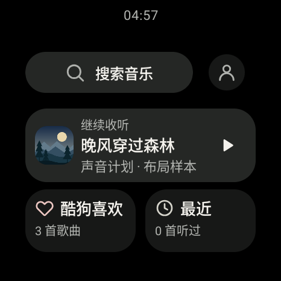
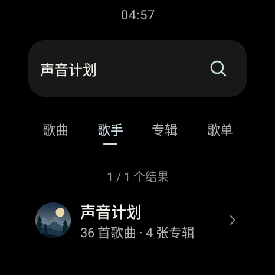
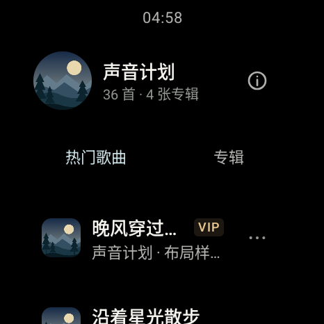

# 腕上听 · WatchListen

为圆形 Android 手表设计的独立音乐客户端。作者：**存存**。

腕上听提供酷狗音乐搜索、账号云歌单、歌词与统一播放器，也支持把自己的音乐原文件传到手表离线播放。主要适配 OPPO Watch X（OWW231），最低支持 Android 11（API 30）。

**[下载最新正式版](https://github.com/yycun-ang/watchlisten/releases/latest)** · [安装与使用](./docs/INSTALL.md) · [版本记录](./CHANGELOG.md) · [隐私说明](./docs/PRIVACY.md) · [反馈问题](https://github.com/yycun-ang/watchlisten/issues)

当前版本：**0.10.0**。本版已在 OPPO Watch X（OWW231 / Android 11）完成旧版覆盖升级、账号云端读取、真实歌曲播放与关键页面检查。完整范围和安装包校验见 [发布验证](./docs/VERIFICATION.md)。

## 功能

- **腕上播放**：圆屏布局、歌曲封面、完整队列、进度控制、整页上滑歌词、睡眠定时、歌曲来源返回。界面、搜索和歌单共用同一个播放器。
- **酷狗账号与云库**：扫码登录、头像和会员资料、云端“我喜欢”与歌单管理。喜欢和移除以服务端读回为准；取消喜欢或移出歌曲后提供 60 秒撤销，撤销失败可在有效期内直接重试。
- **找音乐**：歌曲、歌手、专辑和歌单分类搜索；歌手资料、热门歌曲与专辑；榜单、精选与账号可用的推荐内容。
- **手机传歌与离线音乐**：同一 Wi-Fi 下使用浏览器传入自己的音频原文件，支持任务列表、暂停、分块续传和只重试失败项。离线库提供文件大小、批量整理、原文件导出和本地 LRC 关联。
- **手机投放**：手动开启 DLNA 接收后，可由支持该协议的手机播放器投放音频并控制播放。接收默认关闭。
- **本机诊断**：查看连接与播放状态，按需导出不含账号凭据、歌曲内容和访问地址的状态报告。

## 界面

下列截图使用虚构歌曲、歌手和账号数据，只展示圆屏排版。

  
  
  

## 开始使用

1. 从 [Releases](https://github.com/yycun-ang/watchlisten/releases/latest) 下载 APK，按 [安装说明](./docs/INSTALL.md) 安装到手表。
2. 首次打开阅读隐私与免责声明。登录酷狗时，用手机酷狗扫码并在手机端确认授权。
3. 在首页搜索音乐，或进入“我的音乐”查看云端喜欢、歌单和离线文件。

## 兼容与使用范围

- 会员、试听、版权、地区及实际音质以酷狗服务端对当前账号和歌曲的授权为准。应用不绕过付费、VIP、试听或版权限制；“无损优先”是请求偏好，实际格式以取源结果为准。
- 腕上听是独立第三方客户端，与酷狗官方无隶属或授权合作关系。第三方接口调整可能影响功能。
- 系统文件选择器和语音识别取决于手表固件。没有文件选择器时，可使用手机传入音频；本地 LRC 目前需要手表文件选择器。
- 手机传歌和 DLNA 需要手机、手表处于可互访的同一 Wi-Fi。传歌保留页面与会话才能续传；关闭、换网或 15 分钟到期后会清理暂存。
- DLNA 不等同于酷狗手机与电脑间的 Play 连接，仅接收可直接播放的音频流，暂不支持 DRM 加密内容或 HLS 播放列表。真实手机酷狗、VIP 账号与云端写入的完整兼容性仍需更多实机验证。

本版公开源码已独立构建通过，**442 项应用单元测试与 57 项歌词核心检查通过**。真机结果来自一台 OWW231，其他型号、固件及账号组合仍需分别验证，详见 [发布验证](./docs/VERIFICATION.md) 和对应 [Release 说明](https://github.com/yycun-ang/watchlisten/releases)。

## 构建与反馈

项目使用 Kotlin、Jetpack Compose、Media3 和独立歌词核心。开发与构建方式见 [构建说明](./docs/BUILD.md)。提交问题时，请提供版本、手表型号、系统版本和复现步骤；截图中遮挡二维码、账号与网络地址。

## 版权与许可

本项目自有代码版权由**存存**保留。自有代码的其他使用授权可通过 [Issues](https://github.com/yycun-ang/watchlisten/issues) 联系作者。第三方代码、协议参考及组件依其原许可证使用，详见 [第三方声明](./THIRD_PARTY_NOTICES.md) 和 [许可证目录](./licenses/)。酷狗及相关内容的商标、头像、歌曲与资料属于相应权利人。
